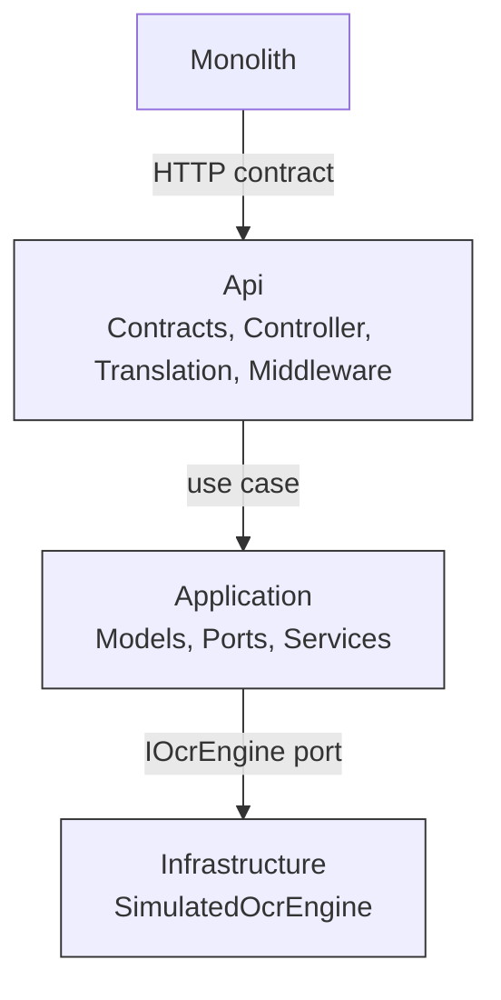
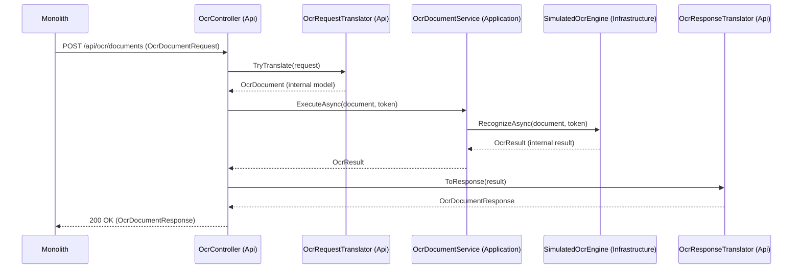

# Architecture and Workflow

This page explains how the PoC ACL is built, how a request travels through it, and how the original contract of the monolith is kept.

## 1. The three layers

[DECISION] The source project `PoC/src/OcrAcl.Api` is split into three layers inside one project (D-35). `PoC/OcrAcl.slnx` holds exactly two projects: `src/OcrAcl.Api` (root namespace `OcrAcl`) and `tests/OcrAcl.Tests`.

- `[IMPLEMENTED]` **Api** — `PoC/src/OcrAcl.Api/Api/`. It holds the external contract types (`Contracts/`), the controller (`Controllers/OcrController.cs`), the translators (`Translation/`) and the error middleware (`Middleware/ContractErrorHandlerMiddleware.cs`). It is the only layer that knows the HTTP contract.
- `[IMPLEMENTED]` **Application** — `PoC/src/OcrAcl.Api/Application/`. It holds the internal models (`Models/OcrDocument.cs`, `Models/OcrResult.cs`), the port (`Ports/IOcrEngine.cs`) and the use case (`Services/OcrDocumentService.cs`). It has no HTTP types.
- `[IMPLEMENTED]` **Infrastructure** — `PoC/src/OcrAcl.Api/Infrastructure/SimulatedOcrEngine.cs`. It implements the port with the deterministic simulation.

[DECISION] **Dependency rule**: `Api` depends on `Application`; `Application` depends on nothing outside itself; `Infrastructure` depends on `Application` (it implements `IOcrEngine`); and `Api` never depends on `Infrastructure` (D-35, T-05). `[VERIFIED]` Three architecture tests enforce this: TC-ARC-001 (reflection over the compiled `Application` types), TC-ARC-002 (source scan of the three folders) and TC-ARC-003 (namespace/folder agreement), all green in `run-02.trx`.

Plain-text description: the monolith talks to the `Api` layer only, through the HTTP contract. `Api` calls the `Application` use case. `Application` sees the OCR engine only as the `IOcrEngine` port; `Infrastructure` implements that port. `Api` has no reference to `Infrastructure`; the composition root wires the two.

## 2. How the layers communicate

[DECISION] The composition root is `PoC/src/OcrAcl.Api/Program.cs` (D-36). `[IMPLEMENTED]` It registers controllers, the port `IOcrEngine` with `SimulatedOcrEngine` (`AddSingleton`), and the use case `OcrDocumentService` (`AddScoped`). That is the only place where the concrete engine is named.

[IMPLEMENTED] The controller `OcrController` (`Api/Controllers/OcrController.cs`) inherits `ControllerBase` with `[ApiController]` and `[Route("api/ocr")]`. It receives `OcrDocumentService` by constructor injection. The port `IOcrEngine.RecognizeAsync(OcrDocument, CancellationToken)` lives in `Application/Ports/IOcrEngine.cs`; the use case `OcrDocumentService.ExecuteAsync(OcrDocument, CancellationToken)` in `Application/Services/OcrDocumentService.cs` forwards to the port.

## 3. The path of a request

### Successful request

[IMPLEMENTED] The external request DTO `OcrDocumentRequest` (`Api/Contracts/OcrDocumentRequest.cs`) is read from the body, then `OcrRequestTranslator.TryTranslate` (`Api/Translation/OcrRequestTranslator.cs`) validates it and builds the internal record `OcrDocument` (`Application/Models/OcrDocument.cs`). The controller calls `OcrDocumentService.ExecuteAsync`, which calls `IOcrEngine.RecognizeAsync`, implemented by `SimulatedOcrEngine` (`Infrastructure/SimulatedOcrEngine.cs`). The engine returns an internal `OcrResult` (`Application/Models/OcrResult.cs`). The controller maps it with `OcrResponseTranslator.ToResponse` (`Api/Translation/OcrResponseTranslator.cs`) into the external DTO `OcrDocumentResponse` and returns `200 OK`.

Plain-text description: the monolith sends the external request. The `Api` translator validates it and produces the internal model. The use case calls the port; the engine produces the internal result. The `Api` response translator builds the external response and the controller answers `200 OK`.

### Failing request

[VERIFIED] A validation error is produced in `Api` and never reaches `Application`: `OcrRequestTranslator.TryTranslate` returns the invalid field names and the controller writes a `400` contract error. Unexpected exceptions are caught by `ContractErrorHandlerMiddleware`, registered first in the pipeline, which writes a `500` contract error with a fixed generic message (D-11, D-12). These paths are proven by the `VAL`, `ERR`, `INT` and `ISO` tests, all green in `run-02.trx`.

## 4. How the original contract is kept

- `[IMPLEMENTED]` The external DTOs live only in `Api/Contracts/`: `OcrDocumentRequest`, `OcrDocumentResponse`, `HealthResponse`, `ContractErrorEnvelope`, `ContractErrorCodes`. They mirror the contract field names and casing (CT-09, CT-20).
- `[DECISION]` Translation happens only in `Api` (D-35, T-06): `OcrRequestTranslator` builds `OcrDocument` and `OcrResponseTranslator` builds `OcrDocumentResponse`. `Application` and `Infrastructure` never see an HTTP type (TC-ARC-001/002).
- `[DECISION]` Errors are produced only by `Api` (D-12, T-26): validation errors in the controller and `OcrController`, and framework-level errors (404, 405, 415, 500) in `ContractErrorHandlerMiddleware`.
- `[DECISION]` Internal details cannot leak: `OcrResult` carries `EngineDescriptor = "SIMULATED-OCR"`, a constant of `SimulatedOcrEngine`, and the response translator copies the contract fields one by one and never copies `EngineDescriptor` (D-23). `[VERIFIED]` This is proven by TC-ISO-001 (only the six contract fields), TC-ISO-002 (no internal marker in the success body), TC-ISO-003 (no internal names in error bodies), TC-ISO-004 (no internal marker in headers) and TC-ISO-005 (no marker in the text), all green in `run-02.trx`.
- `[VERIFIED]` The contract shape itself is proven by the `CON` tests (TC-CON-001 to TC-CON-007) against the literal samples of the contract, all green in `run-02.trx`.

| Part of `Api` | Contract clause it serves |
|---------------|---------------------------|
| `OcrDocumentRequest` | CT-02, CT-03, CT-04, CT-05, CT-06, CT-07, CT-20 |
| `OcrDocumentResponse` | CT-08, CT-09, CT-10 |
| `HealthResponse` | CT-11 |
| `ContractErrorEnvelope`, `ContractErrorCodes` | CT-12, CT-13, CT-14, CT-15, CT-16, CT-17, CT-18 |
| `OcrController` | CT-02, CT-03…CT-11 |
| `ContractErrorHandlerMiddleware` | CT-14, CT-15, CT-16, CT-17, CT-18 |

## 5. The workflow of the work itself

[DECISION] The PoC was produced in six phases (workflow section 2). Phase 5 was first skipped and later enabled (W-04).

| # | Phase | Output |
|---|-------|--------|
| 1 | Contract discovery | `PoC/docs/contract-analysis.md` |
| 2 | Design and test matrix | `PoC/docs/technical-decisions.md`, `PoC/docs/testing/test-cases.md` |
| 3 | Implementation | `PoC/` solution (three layers, tests written) |
| 4 | Testing: execute, fix, repeat | `.trx` runs, filled matrix, `PoC/docs/testing/test-execution-summary.md` |
| 5 | Documentation and findings | `PoC/docs/wiki/*.md` (these 8 pages) |
| 6 | Final validation | `PoC/README.md`, final summary in `PoC/PROGRESS.md` |
